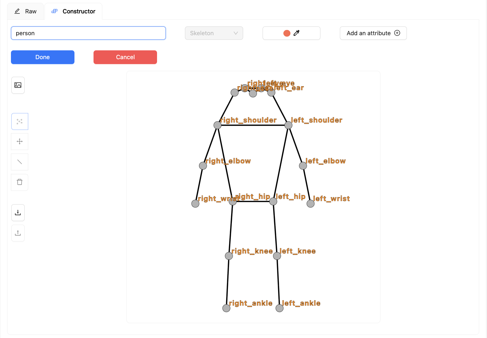
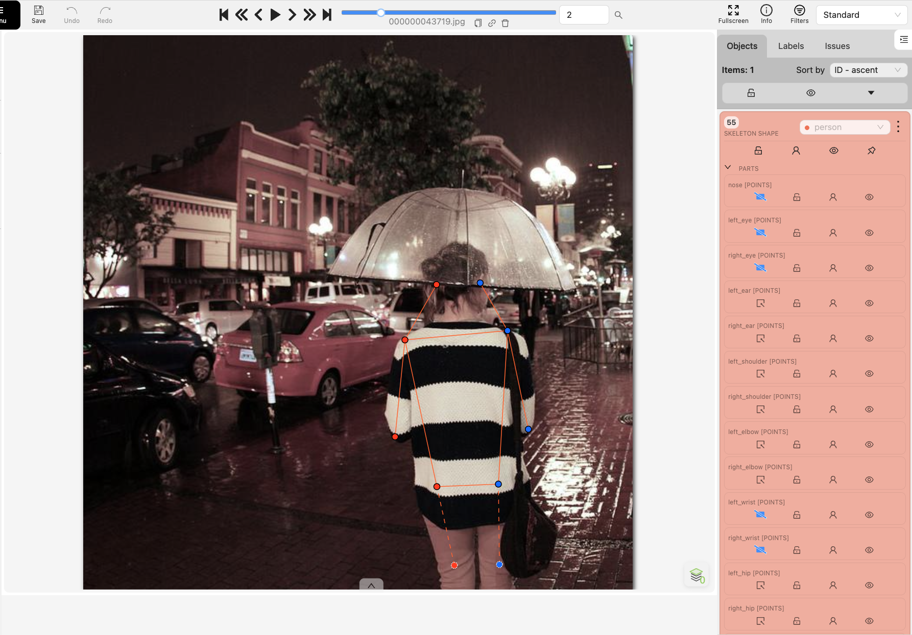
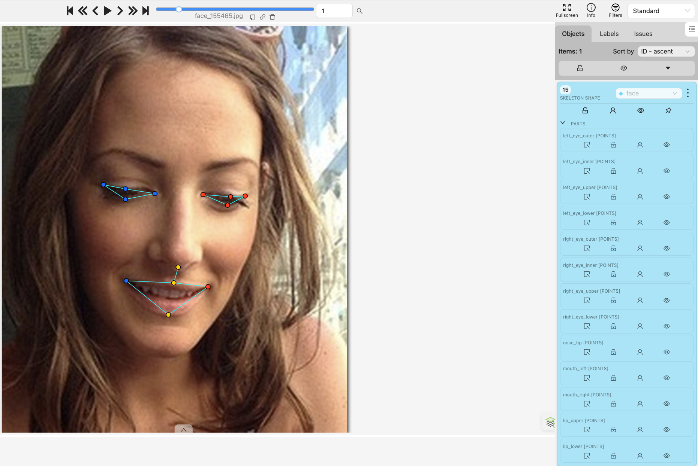
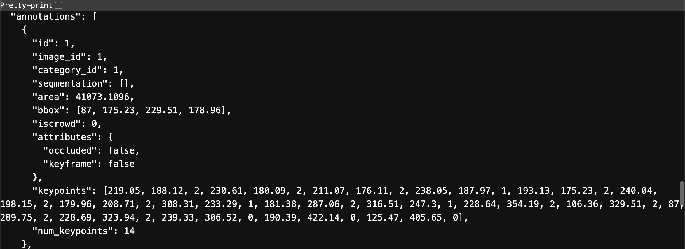

# Báo cáo cá nhân — Tạ Ngọc Huyền Trang — 2A202603251

Dữ liệu: 12 ảnh người COCO val2017 (Lin et al., 2014) và 8 ảnh chân dung Wikimedia Commons, chỉ dùng trong lớp.

## 0. Thông tin cá nhân

- Họ tên: Tạ Ngọc Huyền Trang
- MSSV: 2A202603251
- Email: tnhtrang.works@gmail.com
- Link repository: https://github.com/trangtnh/K5-L2B-DAY04-TaNgocHuyenTrang-2A202603251-KeypointPose
- Phiên bản CVAT: 2.74.1.
- Máy: macOS · RAM 16 GB · CVAT chế độ đầy đủ.
- Bộ ảnh (`src/exports/assignment.json` do `lab.py setup` tạo): Có; MSSV và danh sách 12 ảnh người, 8 ảnh mặt khớp các file xuất.
- Giờ bắt đầu: 16:40 ngày 12/11/2026
- Giờ kết thúc: 18:30 ngày 12/11/2026

## 1. Kiểm tra label (CP0)

| Label | Kiểu | Số điểm | Tên điểm đúng bảng của lab? | Đúng thứ tự? | Số cạnh |
|---|---|---:|---|---|---:|
| `person` | Skeleton | 17 | Khớp | Đúng | 19 |
| `face` | Skeleton | 13 | Khớp | Đúng | 13 |

Mẫu `person` dựng theo người quay mặt về camera (các điểm `left_*` nằm bên phải khung mẫu)? Có; SVG trên CVAT có left_shoulder x=64 > right_shoulder x=36, left_eye x=53,25 > right_eye x=46,75.

Cách đổi cờ cho **một điểm** theo `docs/CVAT_CHEATSHEET.md`: rê chuột vào điểm, nhấn `Q` để bật/tắt occluded hoặc `O` để bật/tắt outside; có thể dùng menu chuột phải của điểm.

## 2. Số lượng đã gán và thời gian (CP1, CP2)

| Nhóm ảnh | Số ảnh | Số skeleton đã gán | Số người dưới 60 px (không gán) | Số poster / gương / màn hình bỏ qua | Thời gian (phút) |
|---|---:|---:|---:|---:|---:|
| `easy` | 5 | 5 |  |  |  |
| `occluded` | 3 | 5 |  |  |  |
| `back` | 2 | 3 |  |  |  |
| `small` | 1 | 3 |  |  |  |
| `crowd` | 1 | 3 |  |  |  |
| `faces` | 8 | 8 | — |  |  |

Các ô trống là số liệu mình chưa ghi lại, không có nghĩa là 0 hoặc không có.

- Số ảnh người đã xong ở mốc phút 105: chưa ghi lại số ảnh tại mốc này.
- Thời gian thực tế (phút): CP1: chưa ghi riêng · CP2: chưa ghi riêng · CP3: chưa ghi riêng. Tổng thời gian: 110 phút.
- Ảnh tốn thời gian nhất: chưa ghi riêng. Ba ảnh mình thấy khó gồm `000000019754.jpg`, `000000109010.jpg` và `000000179201.jpg`.

## 3. Bảng ca khó (CP1, CP2)

| Ảnh | Người / mặt | Điểm | Cờ đã chọn | Phân vân giữa | Lý do chọn |
|---|---|---|---:|---|---|
| `000000019754.jpg` | Người duy nhất | `left_hip` | 2 trong file xuất | v=0 / v=1 | Mình phân vân ở hông trái. Cờ trong file xuất hiện là v=2; quên chưa để thành v=1. |
| `000000109010.jpg` | Người mặc áo choàng đen, bên trái ảnh | `hip`, `knee` | Hai điểm hông hiện v=1 | | Mình phân vân khi gán người mặc áo choàng đen; chưa ghi lại lý do chọn từng điểm. |
| `000000179201.jpg` | Hai người ngồi | Chưa ghi riêng điểm cụ thể | Hông người bên trái: v=0; hông người bên phải: v=1 | | Mình phân vân ở ảnh hai người ngồi; chưa ghi lại lý do chọn từng điểm. |


## 4. Bảng tự review (CP3)

Mình review 5 ảnh người và 3 ảnh mặt, gồm 2 ảnh người quay lưng. Sau đó mình ghi nhận thêm lỗi cờ ở `left_hip` của ảnh `000000019754.jpg`.

Mã lỗi: `lr_swap`, `vis_flag`, `position`, `missing`, `extra`, `ok`.

| Ảnh | Người / mặt | Điểm | Mã lỗi | Ghi chú | Đã sửa? |
|---|---|---|---|---|---|
| `000000451084.jpg` | Các skeleton trong ảnh | Toàn bộ skeleton | `ok` | Không ghi nhận lỗi | Không cần sửa |
| `000000399983.jpg` | Các skeleton trong ảnh | Toàn bộ skeleton | `ok` | Không ghi nhận lỗi | Không cần sửa |
| `000000269462.jpg` (small) | Các skeleton trong ảnh | Toàn bộ skeleton | `ok` | Không ghi nhận lỗi | Không cần sửa |
| `000000043719.jpg` (back) | Các skeleton trong ảnh | Toàn bộ skeleton | `ok` | Không ghi nhận lỗi | Không cần sửa |
| `000000043500.jpg` (back) | Các skeleton trong ảnh | Toàn bộ skeleton | `ok` | Không ghi nhận lỗi | Không cần sửa |
| `face_99874.jpg` | Mặt duy nhất | 13 điểm | `ok` | Không ghi nhận lỗi | Không cần sửa |
| `face_92028.jpg` | Mặt duy nhất | 13 điểm | `ok` | Không ghi nhận lỗi | Không cần sửa |
| `face_562485.jpg` | Mặt duy nhất | 13 điểm | `ok` | Không ghi nhận lỗi | Không cần sửa |
| `000000019754.jpg` | Người duy nhất | `left_hip` | `vis_flag` | Mình quên đổi v=2 thành v=1; file xuất vẫn ghi v=2 | Chưa sửa trong file xuất |

Tổng hợp số lỗi theo mã:

| `lr_swap` | `vis_flag` | `position` | `missing` | `extra` | `ok` |
|---:|---:|---:|---:|---:|---:|
| 0 | 1 | 0 | 0 | 0 | 8 |

Điểm mình từng phân vân giữa v=1 và v=0 là `left_hip` trong `000000019754.jpg`. File xuất hiện ghi v=2; mình quên đổi thành v=1, như đã ghi ở mục 3. Lỗi này chưa được sửa trong file xuất.

## 5. Kiểm file xuất và kết quả tự kiểm (CP4)

Kiểm tra dữ liệu trong JSON:

| File | Người / mặt kiểm (ảnh, thứ tự) | Số phần tử `keypoints` | Điểm `outside` ra `v = 0`, `occluded` ra `v = 1`? | `num_keypoints` khớp? |
|---|---|---:|---|---|
| `TaNgocHuyenTrang_persons.zip` | `000000019754.jpg`, annotation id=1 | 51 | Khớp cờ CVAT | Có: 14 = số điểm v>0 |
| `TaNgocHuyenTrang_persons.zip` | `000000043500.jpg`, annotation id=2 | 51 | Khớp cờ CVAT | Có: 14 = số điểm v>0 |
| `TaNgocHuyenTrang_faces.zip` | `face_99874.jpg`, annotation id=8 | 39 | Khớp cờ CVAT | Có: 5 = số điểm v>0 |

Đã đối chiếu trên CVAT: `occluded` → `v = 1`, `outside` → `v = 0`. JSON thực tế có 85 điểm v=0 vẫn mang tọa độ cũ; trình kiểm ghi nhận đây không phải lỗi. Đã đối chiếu tự động toàn bộ 427 điểm với cờ và tọa độ hiện tại trên CVAT: tất cả khớp trong dung sai làm tròn 0,011 px.

Hai job đã chuyển sang completed trên CVAT? Có. Job 21 (persons) và job 22 (faces) đều state=`completed`, stage=`annotation`, đã đọc trực tiếp trên CVAT.

Kết quả từ `src/check_submission.py`:

```text
- File person: TaNgocHuyenTrang_persons.zip
  Số ảnh: 12 · số skeleton `person`: 19 · mỗi annotation 51 số
  Skeleton theo ảnh: 000000019754=1, 000000043500=2, 000000043719=1, 000000103970=1, 000000109010=2, 000000130816=3, 000000179201=2, 000000213933=1, 000000220045=1, 000000269462=3, 000000399983=1, 000000451084=1
  Cờ v: v=2 173 (54%) · v=1 73 (23%) · v=0 77 (24%)
  num_keypoints trung bình: 12.9
- File face: TaNgocHuyenTrang_faces.zip
  Số ảnh: 8 · số skeleton `face`: 8 · mỗi annotation 39 số
  Skeleton theo ảnh: face_141135=1, face_155465=1, face_223746=1, face_415073=1, face_514826=1, face_562485=1, face_92028=1, face_99874=1
  Cờ v: v=2 81 (78%) · v=1 15 (14%) · v=0 8 (8%)
  num_keypoints trung bình: 12.0
- Ghi chú: 85 điểm v = 0 vẫn mang tọa độ cũ (CVAT 2.x xuất như vậy; chuẩn COCO ghi 0, 0). Không phải lỗi: điểm v = 0 bị bỏ qua khi huấn luyện và khi chấm.
- Số [LỖI]: 0 · số [CẢNH BÁO]: 1
Kết quả: ĐẠT (đọc lại từng cảnh báo ở trên)
```

Các `[CẢNH BÁO]` còn giữ nguyên và lý do:

- `000000130816.jpg #3` (annotation id=10): giữ cảnh báo để giải trình. Đã xem ảnh 640 × 426 px và đối chiếu vị trí skeleton: đó là cầu thủ số 36 ở phía trên bên trái. Chiều cao toàn thân trong ảnh xấp xỉ 70–75 px, lớn hơn ngưỡng 60 px. Script chỉ tính độ trải của các điểm v>0, từ y=54,12 đến y=113,45, tức 59,33 px; các điểm nose/eyes đang v=0 nên không tham gia tính. Vì vậy cảnh báo về độ trải keypoint chưa chứng minh người này thấp hơn 60 px; giữ skeleton. Mình vẫn cần kiểm tra lại visibility của các điểm nose/eyes theo guideline.

## 6. Ảnh chụp màn hình

1. Label `person` trong label constructor (đủ 17 điểm có tên):

   

   Nguồn: label constructor của project `d04-keypoint` trên CVAT cục bộ; mẫu 17 điểm COCO.

2. Một người quay lưng đã gán, cờ đã đặt:

   

   Nguồn: COCO val2017, ảnh `000000043719.jpg`, job 21, frame 2; hiển thị danh sách PARTS và cờ từng điểm.

3. Một khuôn mặt đã gán 13 điểm, phóng to vùng mắt:

   

   Nguồn: Wikimedia Commons, ảnh `face_155465.jpg`, job 22, frame 1; thấy đủ 13 điểm và vùng mắt.

4. Một đoạn JSON xuất của một người:

   

   File: `TaNgocHuyenTrang_persons.zip` → `annotations/person_keypoints_default.json`, annotation id=1. 

   Nguồn ảnh: COCO val2017 / Wikimedia Commons.


## 7. Tự đánh giá

1. Lỗi bạn mắc nhiều nhất hôm nay, và cách bạn sẽ tránh ở dự án thật: lỗi quên gắn cờ hoặc gắn cờ sai

2. Một quy tắc bạn đề xuất thêm vào guideline (kèm ảnh ví dụ nếu có):

3. Nhãn của bạn đi vào model ở đâu? Chọn một lỗi bạn đã sửa và nói nó sẽ làm model học sai thế nào (heatmap, trọng số trong loss, hay bước lật ảnh): Chưa có lỗi đã sửa để lấy làm ví dụ thực tế.

## 8. Khó khăn và lỗi kỹ thuật
Trong lúc gán nhãn, mình chưa gặp lỗi kỹ thuật. Khó khăn chủ yếu là phân vân gắn cờ 

## Bonus (nếu làm)

## 9. Tài liệu tham khảo và công cụ AI đã dùng

- Tài liệu lab: `SUBMISSION.md`, `RULES.md`, `docs/COCO_KEYPOINTS.md` và mẫu báo cáo cá nhân.
- Codex: hỗ trợ đối chiếu dữ liệu CVAT, chỉnh câu chữ từ ghi chú